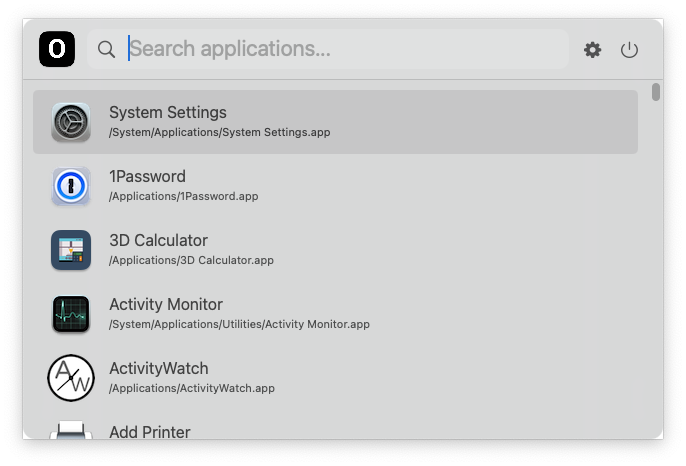
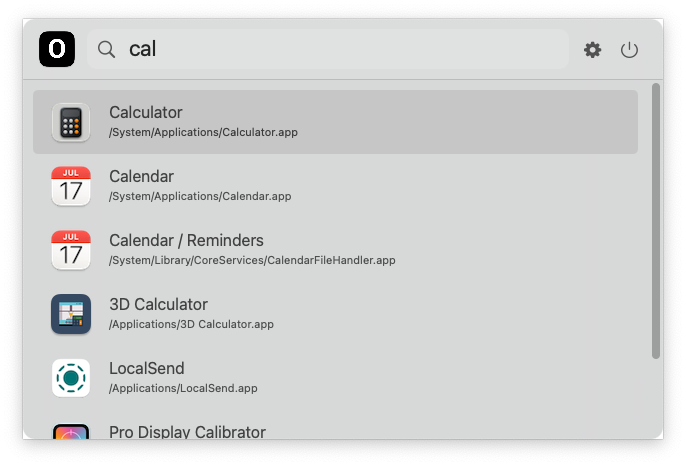
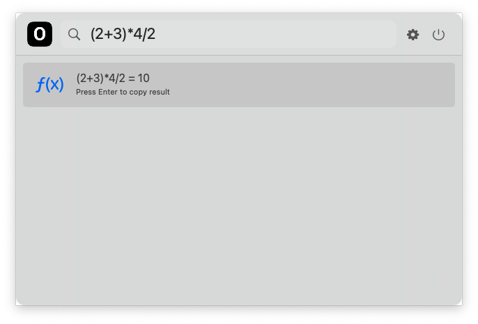
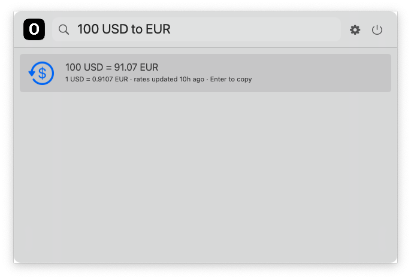
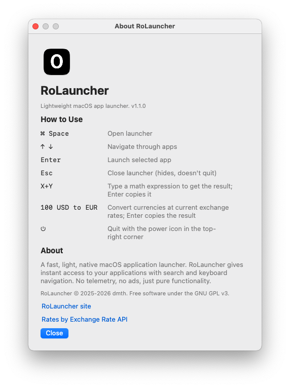

# RoLauncher

A lightweight, native macOS application launcher — a Rust rewrite of OverLauncher.
Uses AppKit directly via [`objc2`](https://github.com/madsmtm/objc2); no webview, no GUI toolkit.



| Search | Calculator |
|---|---|
|  |  |

| Currency conversion |
|---|
|  |



## Install

```sh
./install.sh               # build, copy to /Applications/RoLauncher.app, launch
./install.sh --no-launch   # build and install only
INSTALL_DIR=~/Applications ./install.sh
```

The script quits a running copy before replacing it, and falls back to `sudo` only if the
install directory isn't writable. To start at login, add RoLauncher in
System Settings → General → Login Items.

## Build

```sh
./bundle.sh                      # -> target/release/RoLauncher.app
open target/release/RoLauncher.app
cargo test                       # calculator + search unit tests
cargo run -- --show              # dev run, opens the panel immediately
```

### Screenshots

The images above are generated by the app itself (no Screen Recording permission needed —
a process may always capture its own windows):

```sh
./bundle.sh
target/release/RoLauncher.app/Contents/MacOS/rolauncher --screenshots docs/screenshots
```

## Usage

| Key | Action |
|---|---|
| ⌘ Space | Toggle launcher (disable Spotlight's shortcut in System Settings → Keyboard → Shortcuts) |
| ↑ ↓ | Move selection |
| Enter | Launch app / copy calculation result |
| Esc | Hide launcher |
| ⌘ , | About |
| ⌘ Q | Quit |

Type arithmetic like `(2+3)*4`, `10/4`, `2^10` or `10%3` to get an inline result.

Type `100 USD to EUR` to convert currencies (Enter copies the converted amount). Also accepted:
`100usd in eur`, `$100 to €`, `1,250.50 GBP = JPY`, `2*50 CHF -> USD`. Symbols `$ € £ ¥ ₽ ₴ ₹ ₩ ₺ ₪ ₿`
map to USD, EUR, GBP, JPY, RUB, UAH, INR, KRW, TRY, ILS, BTC.

Rates come from [Exchange Rate API](https://www.exchangerate-api.com)'s free endpoint
(`open.er-api.com`, ~160 currencies, updated daily). They're downloaded only when you type a
conversion, cached in `~/Library/Application Support/RoLauncher/rates.json`, refreshed when
older than 6 hours, and the cached rates keep working offline. This is the app's only network access.

Apps are ranked by how often you launch them: most-used first on an empty query, and as
a tiebreak inside prefix/substring groups while typing. Counts live in
`~/Library/Application Support/RoLauncher/usage.tsv` (delete it to reset).

## Layout

- `src/main.rs` — app setup, activation policy, main menu (for ⌘C/⌘V/⌘Q key equivalents)
- `src/hotkey.rs` — Carbon `RegisterEventHotKey` FFI (no Accessibility permission needed)
- `src/index.rs` — `.app` discovery in `/Applications`, `/System/Applications`, `…/Utilities`, `/System/Library/CoreServices`; search ranking
- `src/usage.rs` — launch counts, persisted as TSV
- `src/currency.rs` — conversion query parsing, rate cache, background fetch
- `src/calc.rs` — recursive-descent arithmetic evaluator
- `src/screenshot.rs` — PNG capture of own windows for `--screenshots`
- `src/ui.rs` — floating search panel, result table, About window
- `resources/` — `Info.plist` (LSUIElement) and app icon

## License

Copyright © 2025-2026 dmth.

RoLauncher is free software: you can redistribute it and/or modify it under the terms of the
GNU General Public License as published by the Free Software Foundation, either version 3 of
the License, or (at your option) any later version. It is distributed WITHOUT ANY WARRANTY;
see [LICENSE](LICENSE) for the full text.
